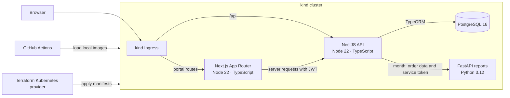

# Customer Portal DevOps Lab

This is a DevOps demo, not a product. All customers, orders and credentials are synthetic. The GitHub Actions workflow builds and deploys the entire stack to a disposable kind cluster on a Linux runner. It needs no added accounts, API keys, repository secrets, cloud infrastructure or Docker installation on your PC.

[](https://github.com/hamza2829/customer-portal-devops-lab/actions/workflows/ci.yml)

## Architecture



The frontend keeps the JWT in an HTTP-only cookie and forwards it server-side. NestJS owns access control and order data. FastAPI computes JSON and CSV summaries from the orders NestJS selects. PostgreSQL and FastAPI use internal service addresses.

## Demo credentials

| Role | Email | Password |
| --- | --- | --- |
| Customer | `customer@example.test` | `portal-demo-2026` |
| Admin | `admin@example.test` | `portal-demo-2026` |

Choose January 2026 to see the seeded report. The admin page lists customers and orders and can create both. OpenAPI documents the complete CRUD endpoints. The two login identities are built-in fixtures. Creating a customer record creates an order owner.

## Run locally with Docker Compose

These commands are optional and intended for a Linux development machine with Docker and the Compose plugin.

```bash
docker compose up --build --wait
```

Open the [portal](http://localhost:3000) or [OpenAPI UI](http://localhost:3001/api/docs). Run `docker compose down` to stop the stack. Add `--volumes` to reset the demo database.

## Run in kind

GitHub Actions performs these steps automatically on pushes to `main` and on pull requests. To repeat the deployment locally on Linux, install Docker with Compose, kind, kubectl, Terraform and [Cloud Provider KIND](https://kind.sigs.k8s.io/docs/user/ingress/). CI pins the tool versions in [the workflow](.github/workflows/ci.yml).

```bash
docker compose build
bash scripts/deploy-kind.sh
sudo --preserve-env=HOME cloud-provider-kind
```

Leave the ingress controller running. From a second terminal in the repository:

```bash
portal_url="$(bash scripts/wait-ingress.sh)"
echo "$portal_url"
# The API docs are at $portal_url/api/docs.
```

To remove the stack, stop the controller and run `terraform -chdir=infra destroy -auto-approve` and `kind delete cluster --name portal`.

## Requirements and test results

See the eight stories and their acceptance criteria in [REQUIREMENTS.md](REQUIREMENTS.md). Each test name contains its story ID. The workflow checks test coverage by story and uploads `portal-test-report` with JUnit XML, a case-by-case TSV and the generated mapping below.

<!-- test-results:start -->
The first Linux workflow run will populate this section.
<!-- test-results:end -->

## Limits

- Kubernetes deployment targets a disposable kind cluster. It provisions no cloud resources.
- Data and credentials are synthetic. The kind database uses ephemeral storage.
- The lab uses plain HTTP, demo secrets and TypeORM schema synchronization. Production hardening, production migrations and secret management are outside scope.
